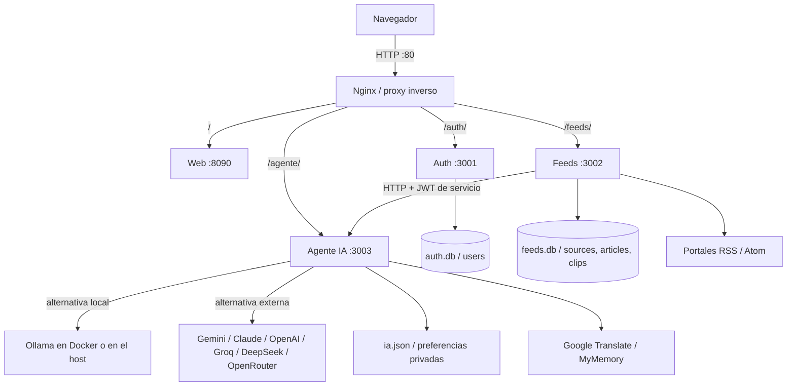

# 📰 Portal IA News

Tu portal de noticias con inteligencia artificial: elegí tus fuentes, organizá
tu lectura y pedí resúmenes o preguntale a la IA sobre una noticia.

**3 microservicios · JWT · RSS · Docker + Nginx · IA local o API externa**

## 🚀 Cómo ejecutarlo

```bash
git clone https://github.com/danny123uwu/News_IA_Plus.git
cd News_IA_Plus
```

### Linux — menú del proyecto

Con Docker instalado y encendido:

```bash
./portal.sh
```

Desde el menú podés **iniciar, detener, ver el estado, consultar errores,
descargar modelos y elegir Ollama del sistema o del contenedor**. No hace falta
memorizar todos los comandos. Abrí **http://localhost** después de iniciar.

La primera vez el lanzador prepara `.env` con una clave propia si no existe
(necesita `openssl` o Node). Si vas a usar IA local, descargá los modelos
desde el menú o desde **IA → Descargar** en la aplicación.

### Windows — lanzador con doble clic

Abrí **`portal.bat`**. Tiene un menú para ejecutar con Node, iniciar/detener
Docker, consultar el estado y descargar modelos. No necesita ejecutar el `.sh`.

- **Sin Docker:** instalá [Node.js 24 LTS](https://nodejs.org/), elegí iniciar
  con Node y abrí **http://localhost:8090**. La primera vez instala dependencias.
- **Con Docker:** encendé Docker Desktop con contenedores Linux y elegí iniciar
  con Docker. Abrí **http://localhost**.

El lanzador crea `.env` con una clave aleatoria si no existe; no reemplaza tu
configuración. Para apagar la ejecución con Node, usá **Ctrl+C** en su consola.

### Sin Docker — Windows, macOS y Linux

Con Node.js instalado (24 LTS recomendado):

```bash
npm ci
npm start
```

Abrí **http://localhost:8090** y creá tu cuenta. La carpeta de datos se prepara
sola. Este arranque es para desarrollo local; `npm start` no lee `.env` por sí
solo. La ejecución con configuración explícita está en [la guía de ejecución](docs/ejecucion.md).

> **Requisitos:** navegador reciente y conexión para importar noticias o usar
> APIs. Ollama y GPU son opcionales. Con Docker no hace falta instalar Node en
> el host; sin Docker sí. No ejecutes dos instancias sobre las mismas bases.

## ✨ Qué podés hacer

- **Seguir portales:** catálogo de 152 fuentes, buscador y detección automática de RSS.
- **Organizar tu feed:** prioridades por medio, intereses, búsqueda y rango de fechas.
- **Leer a tu manera:** noticias con las imágenes y videos disponibles en su RSS.
- **Entender una noticia:** resumen y preguntas en un panel lateral que no mueve la lectura.
- **Guardar lo importante:** favoritos, archivados y recortes de texto.
- **Ponerte al día:** digest de noticias y traducción al español.
- **Personalizar:** perfil, foto, temas, colores, tipografía, tamaños, idioma y aros de estado.
- **Consultar tu actividad:** estadísticas de noticias, lecturas, favoritos y recortes.
- **Elegir tu IA:** Ollama local o Gemini, Claude, Groq, OpenAI, DeepSeek, OpenRouter y API compatible personalizada.

Las fuentes se actualizan automáticamente cada 15 minutos. El contenido de
lectura depende de lo que publique el RSS; **Ver fuente** lleva a la noticia
original. El filtro «último mes» no borra noticias antiguas.

## 🧭 Recorrido rápido

1. **Crear cuenta** e iniciar sesión.
2. **Mis fuentes:** buscar un portal en el catálogo o pegar su dirección.
3. **Para Ti:** leer noticias y ajustar las prioridades de tus medios.
4. **Burbujas superiores:** abrir la portada de una fuente.
5. **Abrir una noticia:** resumir, preguntar, guardar un recorte o visitar el original.
6. **Archivados:** recuperar noticias y fragmentos guardados.
7. **Panel:** consultar estadísticas.
8. **Mi perfil:** cambiar temas, lectura, idioma e intereses.
9. **IA:** configurar modelos o proveedor externo.

📸 [Ver el recorrido con capturas ordenadas](docs/entrega-final.md#recorrido-visual-ordenado).

## 🤖 Configurar la inteligencia artificial

### Modelos locales

El contenedor de Ollama empieza sin modelos. Desde el menú del lanzador elegí
**Descargar modelos** o usá el botón de descarga de la pantalla IA.

| Modelo | Uso recomendado | Descarga aproximada |
|---|---|---:|
| `llama3.2:3b` | Resumir, preguntar y digest | 2 GB |
| `qwen2.5:3b` | Clasificar noticias | 1,9 GB |
| `gemma2:2b` | Alternativa más pequeña | 1,6 GB |

Los tamaños de descarga no incluyen toda la memoria necesaria al ejecutar.
Podés usar **CPU o GPU**, y elegir entre **Ollama dentro de Docker** o el que
ya tengas instalado en tu PC. El cambio no borra los modelos.

En Linux, la opción GPU instala el soporte NVIDIA en Arch/CachyOS y reinicia
Docker: también puede afectar otros proyectos abiertos. Para Windows, usá
Docker Desktop con WSL2 y soporte NVIDIA. [Configuración por plataforma](docs/ejecucion.md).

### API externa

En **IA → API externa**: elegí proveedor, ingresá su clave, pulsá **Ver modelos**,
seleccioná uno, **Probar API** y guardá. Si no querés usar el modelo local,
dejá desmarcado **Usar IA local como respaldo**.

La clave se escribe en la aplicación, no en el código ni en GitHub. La prueba
te permite comprobar si tu cuenta tiene acceso y cuota para el modelo elegido.

## 🏗️ Cómo está organizado

| Servicio | Puerto | Qué hace |
|---|---:|---|
| **Auth** — `services/auth/` | 3001 | Registro, login con JWT, perfil, foto y preferencias. |
| **Feeds** — `services/feeds/` | 3002 | Fuentes RSS, noticias, prioridades, búsqueda, recortes y estadísticas. |
| **Agente IA** — `services/agent/` | 3003 | Resúmenes, preguntas, clasificación, traducción y configuración de modelos. |
| **Web** — `web/` | 8090 | Interfaz que utiliza el usuario. |
| **Nginx** — `deploy/nginx/` | 80 | Proxy inverso: recibe al navegador y dirige cada petición al servicio correcto. |



**Así funciona con Docker:** el navegador entra por Nginx y este reparte
`/auth/`, `/feeds/` y `/agente/`. Las llamadas internas, como **Feeds → Agente**,
van directamente por la red de Docker; no necesitan volver a pasar por Nginx.
Sin Docker, el navegador utiliza los puertos locales de cada servicio.

### Base de datos

Auth guarda los usuarios en **`auth.db`**. Feeds guarda fuentes, artículos y
recortes en **`feeds.db`**. El Agente guarda las preferencias de IA en
**`ia.json`**. Todo se prepara al arrancar.

📐 [Modelo relacional y diccionario](docs/modelo-relacional.md) ·
[SQL de Auth](docs/database/auth.sql) · [SQL de Feeds](docs/database/feeds.sql).

> `data/` y `.env` son privados: contienen bases, fotos y claves. **No se suben
> al repositorio.** Apagar el portal conserva los datos y los modelos descargados.

## 🔧 Errores comunes y soluciones

Los problemas encontrados durante el desarrollo y cómo resolverlos, sin tener
que revisar todo el código.

### Arranque y Docker

| Problema | Causa habitual | Solución |
|---|---|---|
| «Docker no está corriendo» | El motor está apagado. | Abrir Docker Desktop o iniciar Docker en Linux; volver al menú. |
| «image already exists» al construir | Varios servicios intentan construir la misma imagen. | Usar el lanzador: construye una sola vez. A mano: `docker compose build web` y después `docker compose up -d`. |
| Puerto 80 ocupado | Otro servidor usa el puerto. | Liberarlo o usar el arranque sin Docker en :8090; no cerrar procesos de otros proyectos sin comprobarlos. |
| El código actualizado no aparece | La imagen o el navegador conservan la versión anterior. | Elegir **Iniciar / actualizar** y recargar con **Ctrl+Shift+R**. |
| «node/npm no se reconoce» en Windows | Node no está instalado o no está en PATH. | Instalar Node 24 LTS y volver a abrir la consola o el lanzador. |

### Conexión, noticias y datos

| Problema | Causa habitual | Solución |
|---|---|---|
| «502 Bad Gateway» | Un servicio todavía no arrancó o está reiniciándose. | Revisar **Estado** y **Logs** desde el menú. Nginx ya actualiza los nombres internos de Docker. |
| 404 al llamar a una API del portal | Se mezcló la dirección con proxy y la dirección nativa. | Docker: `localhost/auth/...`; sin Docker: `localhost:3001/...`. [Ejemplos](docs/api.md). |
| Un portal no agrega noticias | URL sin RSS, bloqueo del medio o XML defectuoso. | El proyecto busca el RSS y tolera ciertos errores XML; si no lo encuentra, pegar el feed oficial o probar otra fuente. |
| Error de permisos tras borrar `data/` | Docker creó la carpeta con otro propietario. | Volver a iniciar desde el lanzador; `init-datos` prepara sus permisos. No borrar datos mientras el portal está activo. |
| Aparecen archivos `.db-wal` o `.db-shm` | SQLite está trabajando. | Son normales y están ignorados por Git; no borrarlos con la aplicación encendida. |

### Inteligencia artificial

| Problema | Causa habitual | Solución |
|---|---|---|
| El resumen indica «reglas» | No hay modelo disponible o falló el motor. | Leer el aviso; descargar un modelo, encender Ollama o configurar una API. |
| Mucha CPU o respuesta lenta | Inferencia en CPU, carga del modelo o trabajo en curso. | Revisar `ollama ps` durante la generación y la configuración GPU. Cerrar el panel cancela el resumen/pregunta. |
| GPU al 0 % en reposo | No hay generación activa o el modelo se descargó de memoria. | Comprobar durante una respuesta, no solo después; por defecto se libera a los 30 segundos. |
| Ollama del sistema no conecta desde Docker | Solo escucha en `127.0.0.1`. | Configurar una dirección accesible y protegerla con firewall. [Guía](docs/ejecucion.md#ollama-del-sistema). |
| API devuelve 401/403 | Clave incorrecta o falta de permisos. | Revisar la clave del proveedor seleccionado y probar desde IA. |
| API devuelve 404 | Modelo o URL no disponible. | Pulsar **Ver modelos**, elegir uno accesible y probar de nuevo. |
| API devuelve 429 | Cuota agotada o límite de solicitudes. | Revisar saldo/cuota y esperar si es un límite temporal. |
| La traducción no llega | El servicio externo no respondió o aplicó límites. | Reintentar; el portal dispone de servicios de respaldo. |

### Lectura e interfaz

- **Respuestas que se mezclaban al cambiar de noticia:** cada lectura invalida
  las respuestas anteriores; el panel lateral evita mover el artículo.
- **Acciones que desaparecían al bajar:** los botones quedan en una barra fija
  dentro del modal, que también se puede plegar.
- **Temas que se perdían al cambiar de equipo:** se guardan en el perfil,
  además de aplicarse en el navegador.
- **Recortes con error SQL:** se corrigió la consulta de la fuente y el manejo
  de valores vacíos al guardar el fragmento.

## ⌨️ Atajos opcionales

El menú es la entrada principal. Si preferís ir directo, en Linux:

```bash
./portal.sh iniciar       # construir y encender
./portal.sh detener       # apagar sin borrar datos
./portal.sh estado        # consultar servicios
./portal.sh logs agente   # ver errores de IA
./portal.sh modelos       # descargar modelos recomendados
./portal.sh motor host    # elegir Ollama del sistema; aplicar al iniciar
./portal.sh motor docker  # volver al Ollama del contenedor
```

Para pruebas: **`npm test`**. Para probar portales reales: **`npm run test:feeds`**.
En Windows las opciones principales están en `portal.bat`.
**Eliminar** y **Borrar todo** son acciones destructivas, no formas de apagar.

## 📁 Código y documentación

```text
portal.sh / portal.bat   lanzadores de Linux y Windows
start.js                arranque de los cuatro servicios con Node
services/auth/          usuarios y autenticación
services/feeds/         fuentes, noticias y recortes
services/agent/         inteligencia artificial
services/shared/        utilidades compartidas
web/                   interfaz y servidor web
deploy/nginx/           proxy inverso
docs/                  arquitectura, base de datos y capturas
tests/                 pruebas automatizadas
```

📄 [Informe y capturas](docs/entrega-final.md) ·
[Arquitectura](docs/arquitectura.md) · [Rutas para Postman](docs/api.md) ·
[Resultados de pruebas](docs/verificacion.md) · [Otras formas de ejecución](docs/ejecucion.md).

**Proyecto individual:** [danny123uwu](https://github.com/danny123uwu).
**Repositorio público:** https://github.com/danny123uwu/News_IA_Plus
