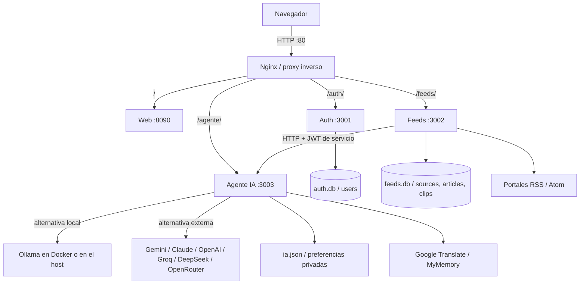

# 📰 Portal IA News

Tu portal de noticias con inteligencia artificial: elegí tus fuentes, organizá
tu lectura y pedí resúmenes o preguntale a la IA sobre una noticia.

**3 microservicios · JWT · RSS · Docker + Nginx · IA local o API externa**

## 🚀 Cómo ejecutarlo

```bash
git clone https://github.com/danny123uwu/News_IA_Plus.git
cd News_IA_Plus
```

### Linux — menú del proyecto

Con Docker instalado y encendido:

```bash
./portal.sh
```

Desde el menú podés **iniciar, detener, ver el estado, consultar errores,
descargar modelos y elegir Ollama del sistema o del contenedor**. No hace falta
memorizar todos los comandos. Abrí **http://localhost** después de iniciar.

La primera vez el lanzador prepara `.env` con una clave propia si no existe
(necesita `openssl` o Node). Si vas a usar IA local, descargá los modelos
desde el menú o desde **IA → Descargar** en la aplicación.

### Windows — lanzador con doble clic

Abrí **`portal.bat`**. Tiene un menú para ejecutar con Node, iniciar/detener
Docker, consultar el estado y descargar modelos. No necesita ejecutar el `.sh`.

- **Sin Docker:** instalá [Node.js 24 LTS](https://nodejs.org/), elegí iniciar
  con Node y abrí **http://localhost:8090**. La primera vez instala dependencias.
- **Con Docker:** encendé Docker Desktop con contenedores Linux y elegí iniciar
  con Docker. Abrí **http://localhost**.

El lanzador crea `.env` con una clave aleatoria si no existe; no reemplaza tu
configuración. Para apagar la ejecución con Node, usá **Ctrl+C** en su consola.

### Sin Docker — Windows, macOS y Linux

Con Node.js instalado (24 LTS recomendado):

```bash
npm ci
npm start
```

Abrí **http://localhost:8090** y creá tu cuenta. La carpeta de datos se prepara
sola. Este arranque es para desarrollo local; `npm start` no lee `.env` por sí
solo. La ejecución con configuración explícita está en [la guía de ejecución](docs/ejecucion.md).

> **Requisitos:** navegador reciente y conexión para importar noticias o usar
> APIs. Ollama y GPU son opcionales. Con Docker no hace falta instalar Node en
> el host; sin Docker sí. No ejecutes dos instancias sobre las mismas bases.

## ✨ Qué podés hacer

- **Seguir portales:** catálogo de 152 fuentes, buscador y detección automática de RSS.
- **Organizar tu feed:** prioridades por medio, intereses, búsqueda y rango de fechas.
- **Leer a tu manera:** noticias con las imágenes y videos disponibles en su RSS.
- **Entender una noticia:** resumen y preguntas en un panel lateral que no mueve la lectura.
- **Guardar lo importante:** favoritos, archivados y recortes de texto.
- **Ponerte al día:** digest de noticias y traducción al español.
- **Personalizar:** perfil, foto, temas, colores, tipografía, tamaños, idioma y aros de estado.
- **Consultar tu actividad:** estadísticas de noticias, lecturas, favoritos y recortes.
- **Elegir tu IA:** Ollama local o Gemini, Claude, Groq, OpenAI, DeepSeek, OpenRouter y API compatible personalizada.

Las fuentes se actualizan automáticamente cada 15 minutos. El contenido de
lectura depende de lo que publique el RSS; **Ver fuente** lleva a la noticia
original. El filtro «último mes» no borra noticias antiguas.

## 🧭 Recorrido rápido

1. **Crear cuenta** e iniciar sesión.
2. **Mis fuentes:** buscar un portal en el catálogo o pegar su dirección.
3. **Para Ti:** leer noticias y ajustar las prioridades de tus medios.
4. **Burbujas superiores:** abrir la portada de una fuente.
5. **Abrir una noticia:** resumir, preguntar, guardar un recorte o visitar el original.
6. **Archivados:** recuperar noticias y fragmentos guardados.
7. **Panel:** consultar estadísticas.
8. **Mi perfil:** cambiar temas, lectura, idioma e intereses.
9. **IA:** configurar modelos o proveedor externo.

📸 [Ver el recorrido con capturas ordenadas](docs/entrega-final.md#recorrido-visual-ordenado).

## 🤖 Configurar la inteligencia artificial

### Modelos locales

El contenedor de Ollama empieza sin modelos. Desde el menú del lanzador elegí
**Descargar modelos** o usá el botón de descarga de la pantalla IA.

| Modelo | Uso recomendado | Descarga aproximada |
|---|---|---:|
| `llama3.2:3b` | Resumir, preguntar y digest | 2 GB |
| `qwen2.5:3b` | Clasificar noticias | 1,9 GB |
| `gemma2:2b` | Alternativa más pequeña | 1,6 GB |

Los tamaños de descarga no incluyen toda la memoria necesaria al ejecutar.
Podés usar **CPU o GPU**, y elegir entre **Ollama dentro de Docker** o el que
ya tengas instalado en tu PC. El cambio no borra los modelos.

En Linux, la opción GPU instala el soporte NVIDIA en Arch/CachyOS y reinicia
Docker: también puede afectar otros proyectos abiertos. Para Windows, usá
Docker Desktop con WSL2 y soporte NVIDIA. [Configuración por plataforma](docs/ejecucion.md).

### API externa

En **IA → API externa**: elegí proveedor, ingresá su clave, pulsá **Ver modelos**,
seleccioná uno, **Probar API** y guardá. Si no querés usar el modelo local,
dejá desmarcado **Usar IA local como respaldo**.

La clave se escribe en la aplicación, no en el código ni en GitHub. La prueba
te permite comprobar si tu cuenta tiene acceso y cuota para el modelo elegido.

## 🏗️ Cómo está organizado

| Servicio | Puerto | Qué hace |
|---|---:|---|
| **Auth** — `services/auth/` | 3001 | Registro, login con JWT, perfil, foto y preferencias. |
| **Feeds** — `services/feeds/` | 3002 | Fuentes RSS, noticias, prioridades, búsqueda, recortes y estadísticas. |
| **Agente IA** — `services/agent/` | 3003 | Resúmenes, preguntas, clasificación, traducción y configuración de modelos. |
| **Web** — `web/` | 8090 | Interfaz que utiliza el usuario. |
| **Nginx** — `deploy/nginx/` | 80 | Proxy inverso: recibe al navegador y dirige cada petición al servicio correcto. |



**Así funciona con Docker:** el navegador entra por Nginx y este reparte
`/auth/`, `/feeds/` y `/agente/`. Las llamadas internas, como **Feeds → Agente**,
van directamente por la red de Docker; no necesitan volver a pasar por Nginx.
Sin Docker, el navegador utiliza los puertos locales de cada servicio.

### Base de datos

Auth guarda los usuarios en **`auth.db`**. Feeds guarda fuentes, artículos y
recortes en **`feeds.db`**. El Agente guarda las preferencias de IA en
**`ia.json`**. Todo se prepara al arrancar.

📐 [Modelo relacional y diccionario](docs/modelo-relacional.md) ·
[SQL de Auth](docs/database/auth.sql) · [SQL de Feeds](docs/database/feeds.sql).

> `data/` y `.env` son privados: contienen bases, fotos y claves. **No se suben
> al repositorio.** Apagar el portal conserva los datos y los modelos descargados.

## 🔧 Errores comunes y soluciones (Troubleshooting)

Esta sección recupera los casos documentados durante el desarrollo, incluyendo
los del README anterior, y añade los cambios posteriores. Cada caso explica
**síntoma → causa → solución → cómo comprobarlo** cuando corresponde.
Los mensajes citados del historial **no son logs nuevos ni pruebas repetidas
en esta revisión**. Las comprobaciones de ejecución están en [Resultados de pruebas](docs/verificacion.md).

### 🐳 Docker y arranque

**1. La construcción falla con `image ... already exists` / `AlreadyExists`**
- **Síntoma:** al construir varios servicios, Docker informa que la imagen ya existe.
- **Causa documentada:** Auth, Feeds, Agente y Web comparten la misma imagen; varias construcciones en paralelo podían intentar etiquetarla a la vez.
- **Solución:** usar **Iniciar / actualizar** del menú. A mano, ejecutar `docker compose build web` una sola vez y después `docker compose up -d`.
- **Comprobación:** consultar el estado de los servicios y abrir el portal; no basta con que la construcción termine.

**2. `permission denied` o «El servicio de Docker no está corriendo»**
- **Causa:** Docker está apagado o el usuario no tiene permiso para acceder a su socket.
- **Solución en Linux:** comprobar `systemctl status docker`; si corresponde, iniciar con `sudo systemctl start docker`. Si el problema es el grupo, configurar el acceso y volver a iniciar sesión. El grupo `docker` concede privilegios elevados.
- **En Windows:** abrir Docker Desktop con contenedores Linux antes de seleccionar la opción Docker.

**3. Los contenedores se levantan solos al prender la PC**
- **Causa:** la política de reinicio de Docker.
- **Solución:** el proyecto usa `RESTART_POLICY=no`. Para cambiarla voluntariamente, editar `.env` y volver a aplicar el despliegue; `unless-stopped` permite reinicio automático.
- **Aclaración:** el servicio Ollama instalado en el sistema tiene su propia política; apagar el portal no la modifica.

**4. `address already in use` / puerto 80 ocupado**
- **Causa:** otro servidor ya utiliza el puerto publicado por Nginx.
- **Solución:** identificar el proceso con `sudo lsof -i :80`, sin detener servicios ajenos a ciegas. Como alternativa, ejecutar con Node en :8090 o cambiar el mapeo de Nginx a `8080:80`.
- **Comprobación:** con ese mapeo la dirección pasa a ser `http://localhost:8080`. El lanzador tiene la dirección :80 predeterminada; sus mensajes de URL no se ajustan automáticamente.

**5. `node` o `npm` no se reconoce en Windows**
- **Causa habitual:** falta Node o la consola no recibió su nueva variable PATH.
- **Solución:** instalar Node.js 24 LTS, cerrar y volver a abrir la consola y comprobar `node --version` / `npm --version`.
- **Alcance de prueba:** la ayuda y el menú de `portal.bat` se comprobaron con `cmd` de Wine. Sus instrucciones PowerShell y el arranque completo necesitan validación en Windows real; no están cubiertos por esa prueba del menú.

**6. Actualicé el código, pero sigo viendo la versión anterior**
- **Causa:** Docker ejecuta la copia incluida en la imagen, y el navegador puede conservar recursos anteriores.
- **Solución:** **Iniciar / actualizar** para reconstruir la imagen; después **Ctrl+Shift+R** en el navegador.
- **Sin Docker:** reiniciar los procesos Node tras cambiar el backend; no hace falta reconstruir una imagen.

### 🌐 Nginx y conexión entre servicios

**7. `502 Bad Gateway` después de recrear un contenedor**
- **Causa histórica:** Nginx podía conservar una IP anterior al recrear el servicio.
- **Cambio realizado:** `deploy/nginx/default.conf` utiliza el DNS interno `127.0.0.11`, resolución con vigencia de 10 segundos y destinos mediante variables.
- **Si aparece ahora:** consultar **Estado** y **Logs**. Un servicio apagado o que falla al arrancar también produce 502; no todo 502 significa un problema de DNS.
- **Comprobación:** `docker compose ps` y `docker compose logs --tail 40 agente` (o el servicio afectado).

**8. `/auth`, `/feeds` o `/agente` responde 404**
- **Causa:** mezclar las rutas del proxy con los puertos de ejecución nativa.
- **Con Docker:** `http://localhost/auth/me` llega a Auth a través de Nginx.
- **Sin Docker:** la misma ruta se consulta como `http://localhost:3001/me`.
- **Detalle de Feeds:** la lista pública de fuentes es `/feeds/feeds`; el primer segmento es el prefijo de Nginx. [Ver rutas completas](docs/api.md).

### 🗄️ Base de datos y archivos

**9. `EACCES: permission denied, mkdir '/app/data/uploads'` tras borrar `data/`**
- **Causa documentada:** Docker creaba la carpeta montada como root, pero los servicios Node se ejecutan con UID/GID 1000.
- **Cambio realizado:** `init-datos` prepara la carpeta y los permisos antes de iniciar Auth, Feeds y Agente.
- **Solución:** volver a iniciar mediante el lanzador; no borrar la carpeta con el portal funcionando.
- **Comprobación:** `ls -ld data data/uploads` y estado de los servicios Node. En equipos con otro UID, revisar los permisos del montaje, no aplicar permisos globales indiscriminadamente.

**10. HTTP 500 al guardar un recorte**
- **Causa histórica:** se utilizaba el nombre del medio sin obtenerlo en la consulta; un parámetro podía llegar como `undefined`, que `node:sqlite` no admite.
- **Cambio realizado:** la consulta incorpora `JOIN sources` para obtener la fuente, y los campos opcionales se convierten a valores aceptados por SQLite.
- **Comprobación:** guardar un fragmento desde una noticia y abrir **Archivados → Mis recortes**. Si falla, consultar los logs de Feeds antes de atribuirlo al mismo error antiguo.

**11. Aparecen `.db-wal`, `.db-shm` o `.db-journal`**
- **Causa:** archivos auxiliares del mecanismo de escritura de SQLite. WAL y SHM son normales en el modo utilizado por el proyecto.
- **Solución:** no borrarlos mientras la base está abierta; están excluidos de Git. Para copiar los archivos de base manualmente, detener primero el portal.
- **Importante:** un error de base bloqueada es un síntoma distinto; comprobar que no haya dos instancias trabajando sobre los mismos datos.

**12. `data/` o `.env` aparece entre los archivos que se van a subir**
- **Riesgo:** contienen bases personales, fotos, secretos y preferencias de API.
- **Solución:** comprobar `.gitignore` y `git status` antes de publicar. Solo `.env.example` y el SQL de estructura pertenecen a la entrega pública.
- **Si ya se publicaron claves:** ignorar el archivo después no elimina el secreto del historial; hay que revocar las claves expuestas y tratar ese historial por separado.

### 🤖 Modelos locales, GPU y API externas

**13. Ollama sigue ocupando RAM/VRAM después de responder**
- **Causa:** el modelo permanece cargado durante su tiempo de conservación.
- **Configuración del proyecto:** un modelo cargado a la vez y `OLLAMA_KEEP_ALIVE=30s`. Usar `0` solicita liberarlo inmediatamente al terminar; conservarlo más tiempo puede agilizar la siguiente respuesta.
- **Comprobación:** `docker compose exec ollama ollama ps` mientras está cargado y después del tiempo configurado. No confundir memoria del proceso/caché con un modelo todavía activo.

**14. La IA utiliza CPU aunque hay una NVIDIA disponible**
- **Causas a distinguir:** Docker no tiene acceso a NVIDIA, no se aplicó la sobrecapa GPU, falta memoria para todas las capas o se está observando trabajo auxiliar de CPU.
- **Solución:** comprobar durante una generación `docker compose exec ollama ollama ps` y los logs de Ollama. El lanzador Linux aplica `docker-compose.gpu.yml` cuando detecta el runtime NVIDIA.
- **Comprobación real de este proyecto:** se observaron `100% GPU` y `29/29` capas en la RTX 3050. Tener CPU activa no demuestra que haya vuelto al modo CPU; la GPU también puede marcar 0 % en reposo.
- **Instalación:** la opción GPU de Linux instala soporte en Arch/CachyOS y reinicia Docker. No repetirla solo porque la GPU esté desocupada; afecta también a otros proyectos.

**15. Seleccioné API externa, pero el trabajo de fondo usa el modelo local**
- **Causa histórica:** las tareas de Feeds llegaban con identidad de servicio, sin tomar la configuración del propietario de las noticias.
- **Cambio realizado:** Feeds envía `userId` y el Agente utiliza esa configuración. No se activa el respaldo Ollama si el usuario lo dejó deshabilitado.
- **Comprobación:** revisar el motor devuelto y la casilla **Usar IA local como respaldo**. Otro usuario o aplicación también puede estar utilizando Ollama; no atribuir todo su consumo a la misma cuenta.

**16. Gemini: «el modelo … no existe o ya no está disponible»**
- **Causa posible:** el proveedor retiró el modelo o la cuenta no tiene acceso; una URL incorrecta también puede dar 404.
- **Cambio realizado:** la configuración migra ciertos nombres antiguos de Gemini al modelo de referencia del proyecto.
- **Solución práctica:** **IA → Ver modelos**, seleccionar uno disponible para tu cuenta y **Probar API**. El nombre predeterminado no garantiza acceso ni cuota.

**17. «Ver modelos» mostraba modelos de Gemini que fallaban al generar**
- **Causa histórica:** se listaban desde la API nativa de Google, pero se generaba por su interfaz compatible con OpenAI; las capacidades expuestas no coincidían.
- **Cambio realizado:** generación y listado de Gemini usan la API nativa; el listado filtra modelos que anuncian `generateContent`.
- **Comprobación:** probar con la propia clave. Usar el mismo protocolo evita esa incompatibilidad, pero no elimina restricciones de permisos, región o cuota.

**18. El desplegable de modelos no mostraba opciones**
- **Causa histórica:** el uso de `datalist` no ofrecía un despliegue consistente entre navegadores.
- **Cambio realizado:** se utiliza un `select` que se llena al pulsar **Ver modelos**.
- **Si sigue vacío:** revisar el mensaje de la API y que se haya introducido la clave del proveedor seleccionado.

**19. La traducción vuelve vacía o falla**
- **Causa documentada:** un endpoint anterior de traducción por lotes no respondía desde algunas IPs. Los servicios gratuitos también pueden imponer límites o cambiar su comportamiento.
- **Cambio realizado:** se utiliza otro endpoint de Google, caché y respaldos con MyMemory y, según la ruta/configuración, el motor de IA.
- **Solución:** revisar el mensaje, reintentar sin lanzar muchas solicitudes y conservar el acceso al texto original. No se garantiza la disponibilidad de terceros.

**20. El resumen muestra `**asteriscos**` en lugar de formato**
- **Causa histórica:** se presentaba el Markdown del modelo como texto sin formato.
- **Cambio realizado:** la interfaz interpreta negritas, viñetas y fragmentos de código en resúmenes, preguntas y digest.
- **Comprobación:** revisar la respuesta en la interfaz, no solo el JSON del endpoint, donde el Markdown es esperable.

**21. La respuesta indica `motor: "reglas"`**
- **Causa posible:** no hay modelos descargados, Ollama está apagado, falló la API o la salida generada fue descartada.
- **Caso observado:** el volumen del contenedor de Ollama estaba vacío. Los modelos del host no aparecen automáticamente en ese volumen.
- **Solución:** leer el aviso y comprobar `docker compose exec ollama ollama list`. Descargar modelos desde el menú o configurar una API externa.
- **Aclaración:** `reglas` es un respaldo automático, no una respuesta generada por un modelo. HTTP 200 por sí solo no demuestra que la IA haya funcionado.

**22. Descargué otro modelo, pero parece que sigue utilizando el anterior**
- **Causa histórica:** la selección automática quedaba fijada aunque cambiara la lista de modelos.
- **Cambio realizado:** se actualiza la selección automática cuando cambia la lista instalada.
- **Comprobación:** revisar el motor mostrado en la respuesta y **Modelos por tarea**. Un modelo elegido manualmente sigue teniendo prioridad sobre la selección automática.

**23. «No se pudo conectar con el servidor» durante una generación larga**
- **Caso observado:** hubo solicitudes lentas y un corte del cliente registrado como `499` en Nginx. `499` significa que el cliente cerró la conexión; no es, por sí solo, una caída del servidor.
- **Cambio realizado:** cronómetro visible, cancelación al cerrar el panel, límite de espera de 150 segundos y propagación de la cancelación hacia Ollama.
- **Diagnóstico:** correlacionar la hora del error con los logs de Nginx, Agente y Ollama; un problema de red real también puede producir el mensaje.
- **Acción:** comprobar el motor activo y su rendimiento; no lanzar repetidamente la misma petición mientras otra sigue trabajando.

**24. La IA repite una frase hasta llenar la respuesta**
- **Causa posible:** la generación entró en un bucle; no implica que el artículo original contenga esa repetición.
- **Cambio realizado:** penalización de repetición y detección heurística de salidas repetitivas en resúmenes, preguntas y traducciones locales.
- **Resultado:** cuando se detecta, se descarta esa salida y se informa del respaldo correspondiente. La detección no sustituye revisar el contenido ni garantiza eliminar toda repetición.

**25. El Ollama del sistema responde en el host, pero no desde Docker**
- **Causa habitual en Linux:** escucha solo en `127.0.0.1`, que no es la interfaz accesible desde la red bridge del contenedor.
- **Solución:** configurar una dirección alcanzable y `OLLAMA_HOST_URL`, restringiendo el acceso con firewall. [Pasos](docs/ejecucion.md#ollama-del-sistema).
- **Protección:** el lanzador comprueba la conexión antes de detener el Ollama del contenedor. No abrir la API de modelos a Internet; no exige contraseña por defecto.

**26. Cambié de proveedor, pero se reutilizaba la clave anterior**
- **Causa detectada en revisión:** conservar la clave al cambiar la configuración podía enviarla a otro proveedor o dominio.
- **Cambio realizado:** el backend no reutiliza la clave guardada si cambia el proveedor/destino; la interfaz también limpia la clave que se estaba escribiendo.
- **Uso:** ingresar la clave específica del nuevo proveedor antes de listar modelos o probar. No pegar claves en capturas ni en mensajes de error públicos.

**27. Claude aparecía como opción, pero se llamaba con el protocolo incorrecto**
- **Causa detectada en el código:** se trataba Anthropic como una API compatible con OpenAI.
- **Cambio realizado:** se utilizan `/messages`, `x-api-key`, la versión de API y el formato de respuesta nativos de Anthropic.
- **Verificación disponible:** contratos con respuestas simuladas en las pruebas. Para confirmar una cuenta concreta hace falta su clave real; no se presenta esa simulación como una llamada facturada exitosa.

**28. API responde 401, 403 o 429; o «Probar API» parecía funcionar gracias a Ollama**
- **401/403:** revisar autenticación y permisos del proveedor. **429:** revisar límites de solicitudes o cuota/saldo.
- **Cambio realizado en la prueba:** **Probar API** no recurre a Ollama para aparentar una conexión externa exitosa.
- **Comprobación:** el resultado debe identificar el proveedor externo. La prueba no guarda cambios y no garantiza que todos los modelos de la cuenta estén habilitados.

### 🖥️ Lectura e interfaz

**29. Al abrir noticias rápido se mezclaba el contenido de dos artículos**
- **Causa histórica:** una respuesta de traducción o IA llegaba cuando ya se estaba leyendo otro artículo.
- **Cambio realizado:** se comprueba a qué lectura y solicitud pertenece cada respuesta asíncrona; cerrar o cambiar de noticia invalida las anteriores en esos flujos.
- **Comprobación:** abrir otra noticia mientras hay una solicitud en curso y verificar que la respuesta no se inserte en la lectura equivocada.

**30. El modal mostraba la página web original entera**
- **Causa histórica:** el contenido se enriquecía extrayendo la web del medio.
- **Cambio realizado:** se muestra el cuerpo proporcionado por el RSS con su multimedia admitida; no se copia la página completa.
- **Uso:** si el RSS solo incluye un extracto, **Ver fuente ↗** lleva a la noticia original.

**31. «Resumir / Preguntar» desaparecía al bajar, o la respuesta movía la lectura**
- **Causa histórica:** las acciones y la respuesta estaban dentro del flujo de contenido.
- **Cambio realizado:** barra de acciones fija al pie del modal y panel IA que entra desde la derecha sin cambiar la posición del artículo.
- **Uso:** **Ocultar acciones** pliega los botones; Escape cierra primero el panel de IA y después el artículo.

**32. El tema o la apariencia se perdía al cambiar de equipo**
- **Causa histórica:** la preferencia solo se tomaba del almacenamiento del navegador.
- **Cambio realizado:** se guardan en la cuenta los temas, tipografía, tamaños, colores y aros; el navegador los utiliza además para aplicarlos de inmediato.
- **Comprobación:** volver a iniciar sesión con la misma cuenta. Si aparecen recursos antiguos después de actualizar, usar **Ctrl+Shift+R**.

### 📰 Fuentes y feeds RSS

**33. `Status code 404` / `Unexpected close tag…` al agregar un sitio que sí abre**
- **Síntoma histórico:** una portada, como `https://laboratoriolinux.es/index.php`, abría en el navegador pero fallaba como fuente.
- **Causa:** una página HTML no es un feed XML. La dirección podía no tener RSS en esa ruta, o el parser intentaba interpretar HTML como XML.
- **Cambio realizado:** primero se reconoce si la respuesta ya es un feed; si no, se buscan enlaces RSS/Atom declarados y luego rutas comunes de WordPress, Joomla, Blogger y otros formatos compatibles.
- **Resultado:** se guarda la URL real del feed y puede aparecer el aviso **feed detectado**. Si no existe o no se encuentra un feed, el sitio no se puede importar por este mecanismo.

**34. El RSS trae XML defectuoso y no carga**
- **Ejemplos documentados:** `&` sin escapar, `&nbsp;`, `<br>` mal cerrado, avisos de PHP antes de la raíz o basura después de `</rss>`.
- **Cambio realizado:** limpieza previa, intento de parser estricto y tolerante y rescate de elementos cuando es posible. También se normalizan entidades de títulos y enlaces relativos.
- **Comprobación:** `npm run test:feeds` incluye un XML defectuoso de prueba. No implica que cualquier documento roto se pueda recuperar por completo.

**35. Un medio bloquea la descarga con HTTP 403**
- **Causa posible:** protección anti-bot, restricciones del medio o rechazo de solicitudes automáticas.
- **Cambio realizado:** la descarga envía User-Agent de navegador y cabeceras apropiadas para feeds, además de mensajes de error comprensibles.
- **Acción:** usar el feed oficial si está disponible o elegir otra fuente. Esas cabeceras no garantizan evitar Cloudflare ni autorizan saltarse restricciones del medio.

**36. Agregar una URL sin feed tarda bastante**
- **Causa:** después de probar la URL inicial se buscan feeds declarados y varias rutas candidatas.
- **Funcionamiento:** se prueban hasta cuatro candidatos en paralelo, con tiempos de espera acotados por solicitud. Las fases, redirecciones y tiempos de red influyen en el total.
- **Acción:** esperar el resultado sin reenviar repetidamente la petición. No se promete un tiempo máximo global de 25 segundos; ese valor del README anterior no cubría todos los recorridos.

### 📋 Comprobación rápida

```bash
./portal.sh estado
./portal.sh logs agente
docker compose logs --tail 40 feeds
docker compose exec ollama ollama ps
docker compose exec ollama ollama list
curl http://localhost/agente/health
npm run test:feeds
```

Los cuatro servicios Node declaran healthcheck; Nginx y Ollama no tienen que
mostrar `healthy` para estar ejecutándose. Consultar también la ruta afectada:
un healthcheck de proceso no demuestra por sí solo que una API externa funcione.

## ⌨️ Atajos opcionales

El menú es la entrada principal. Si preferís ir directo, en Linux:

```bash
./portal.sh iniciar       # construir y encender
./portal.sh detener       # apagar sin borrar datos
./portal.sh estado        # consultar servicios
./portal.sh logs agente   # ver errores de IA
./portal.sh modelos       # descargar modelos recomendados
./portal.sh motor host    # elegir Ollama del sistema; aplicar al iniciar
./portal.sh motor docker  # volver al Ollama del contenedor
```

Para pruebas: **`npm test`**. Para probar portales reales: **`npm run test:feeds`**.
En Windows las opciones principales están en `portal.bat`.
**Eliminar** y **Borrar todo** son acciones destructivas, no formas de apagar.

## 📁 Código y documentación

```text
portal.sh / portal.bat   lanzadores de Linux y Windows
start.js                arranque de los cuatro servicios con Node
services/auth/          usuarios y autenticación
services/feeds/         fuentes, noticias y recortes
services/agent/         inteligencia artificial
services/shared/        utilidades compartidas
web/                   interfaz y servidor web
deploy/nginx/           proxy inverso
docs/                  arquitectura, base de datos y capturas
tests/                 pruebas automatizadas
```

📄 [Informe y capturas](docs/entrega-final.md) ·
[Arquitectura](docs/arquitectura.md) · [Rutas para Postman](docs/api.md) ·
[Resultados de pruebas](docs/verificacion.md) · [Otras formas de ejecución](docs/ejecucion.md).

**Proyecto individual:** [danny123uwu](https://github.com/danny123uwu).
**Repositorio público:** https://github.com/danny123uwu/News_IA_Plus
