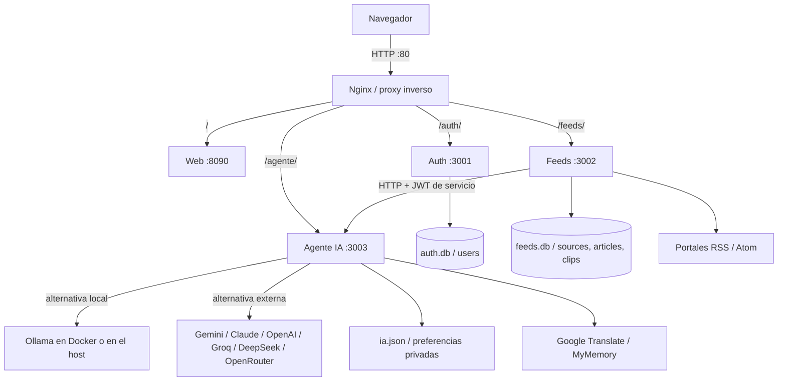

# Portal IA News — Proyecto final

Portal de noticias RSS con **tres microservicios de negocio**, frontend independiente,
autenticación JWT, personalización y asistente de inteligencia artificial local o externo.

**Entrega:** 26 de octubre de 2026, 23:59. **Modalidad:** individual, confirmada por el autor.
**Autor en Git:** [danny123uwu](https://github.com/danny123uwu).
**Repositorio público:** <https://github.com/danny123uwu/News_IA_Plus>.
No requiere invitación al docente mientras siga siendo público.

## Documentación de entrega

- [Informe final y recorrido con capturas numeradas](docs/entrega-final.md).
- [Modelo relacional y diccionario de datos](docs/modelo-relacional.md).
- SQL sin datos personales: [auth.sql](docs/database/auth.sql) y [feeds.sql](docs/database/feeds.sql).
- [Arquitectura detallada](docs/arquitectura.md) y [catálogo de endpoints](docs/api.md).
- [Revisión técnica: alcance, límites y mejoras](docs/revision-tecnica.md).
- [Evidencias de verificación](docs/verificacion.md).

## 1. Arquitectura




El navegador se autentica con `Authorization: Bearer <JWT>`. Cada servicio de
negocio valida la firma HS256. Feeds envía al agente el usuario propietario de
las noticias para respetar su elección de IA. No hay broker de mensajes: las
colas son internas al proceso y la comunicación entre servicios es HTTP.

### Responsabilidades y funcionalidades

| Servicio | Código | Puerto interno | Funcionalidades |
|---|---|---:|---|
| Auth | `services/auth/` | 3001 | Registro, login, JWT de 8 horas, perfil, intereses, idioma, foto y preferencias visuales. Contraseñas con scrypt y sal. |
| Feeds | `services/feeds/` | 3002 | Alta/consulta/edición/baja de fuentes; descubrimiento RSS; importación y actualización; feed por prioridad, fecha e intereses; búsqueda; leídos, favoritos, archivados, recortes y estadísticas. |
| Agente IA | `services/agent/` | 3003 | Clasificación, resúmenes, preguntas, digest, traducción, configuración por usuario, descarga de modelos locales y prueba/listado de modelos de API. |
| Web | `web/` | 8090 | Interfaz HTML/CSS/JavaScript sin framework: catálogo, lectura multimedia RSS, panel lateral IA sin desplazar el artículo, temas y ajustes de lectura. |
| Nginx | `deploy/nginx/` | 80 publicado | Entrada única, enrutamiento, gzip, límites y cabeceras de seguridad. |
| Ollama, opcional | imagen oficial o instalación del sistema | 11434 | Ejecuta modelos locales. Puede reemplazarse por API externa. |

En Docker se ejecutan seis servicios persistentes en el modo local habitual;
`init-datos` prepara permisos y termina. Solo los cuatro servicios Node tienen
healthchecks en Compose; no se debe esperar la etiqueta `healthy` en los seis.

## 2. Modelo relacional


Se usan **dos bases SQLite**, no una base compartida entre todos los servicios:
`auth.db` contiene `users`; `feeds.db` contiene `sources`, `articles` y `clips`.
Los IDs de usuario en Feeds son referencias lógicas entre servicios, **sin FK
entre archivos SQLite**. Tampoco se declaran `FOREIGN KEY` en las tablas de Feeds:
las relaciones se controlan en consultas y rutas. Los diagramas no inventan esas restricciones.
El agente persiste su configuración en JSON, no en una quinta tabla SQL.

Las tablas y migraciones se crean al iniciar. No hace falta importar el SQL para
usar la aplicación; los archivos SQL publicados describen el esquema final sin usuarios,
contraseñas, noticias ni claves privadas. [Diccionario completo](docs/modelo-relacional.md).

## 3. Requisitos

- Git, navegador reciente y conexión para importar noticias/usar APIs.
- **Con Docker:** Docker Engine o Desktop y Compose V2. No hace falta Node en el host.
- **Sin Docker:** Node.js **24 LTS recomendado** y npm (mínimo declarado: 22.5).
  Se usa `node:sqlite`, incluido en Node, y `fetch` nativo.
- **IA local opcional:** Ollama y espacio para descargar los modelos. GPU no obligatoria.
- `portal.sh` requiere Bash y utilidades de Linux (`readlink -f`, curl).
  En Windows usá WSL2 o Compose; en macOS usá Compose o Node directamente.

## 4. Descargar y preparar la configuración

```bash
git clone https://github.com/danny123uwu/News_IA_Plus.git
cd News_IA_Plus
```

Para Docker o ejecución nativa con configuración explícita, creá `.env` **solo
si no existe**. Este comando funciona en Bash y PowerShell y genera una clave
JWT aleatoria; no imprime la clave ni sobrescribe una configuración existente:

```bash
node -e "const fs=require('fs');if(!fs.existsSync('.env'))fs.writeFileSync('.env',fs.readFileSync('.env.example','utf8').replace(/^JWT_SECRET=.*$/m,'JWT_SECRET='+require('crypto').randomBytes(32).toString('hex')),{mode:384});"
```

Si solo tenés Docker y no Node: copiá `.env.example` a `.env` con tu editor y
reemplazá `JWT_SECRET` por una clave aleatoria de al menos 32 caracteres
(`openssl rand -hex 32` en Linux/macOS). **No uses la clave de ejemplo**.
Nunca publiques `.env`, `data/`, bases ni claves; están ignorados por Git.

## 5. Formas de ejecutar

### A. Linux: lanzador y modelos dentro de Docker

```bash
./portal.sh motor docker  # guarda la elección; no es necesario repetirlo
./portal.sh iniciar       # construye una sola imagen y levanta la aplicación
./portal.sh modelos       # primera vez: descarga qwen2.5:3b y llama3.2:3b
```

Abrí **http://localhost**. `./portal.sh` sin argumentos muestra el menú.
Si el runtime NVIDIA está instalado, el lanzador añade la sobrecapa de GPU.
Sin él, Ollama puede funcionar con CPU. Elegir el motor no enciende el portal;
`iniciar` aplica la selección guardada en `.env` (`OLLAMA_MODO`).

### B. Docker Compose manual: CPU, Windows/macOS/Linux

```bash
docker compose -f docker-compose.yml build web
docker compose -f docker-compose.yml up -d
docker compose exec ollama ollama pull qwen2.5:3b
docker compose exec ollama ollama pull llama3.2:3b
```

Abrí **http://localhost**. Las dos descargas son opcionales si vas a usar API.
Construí `web` una sola vez: los servicios Node comparten imagen.
El Compose básico **no selecciona GPU automáticamente**.

### C. Docker Compose manual con GPU NVIDIA

Requiere driver compatible y NVIDIA Container Toolkit en Linux/WSL según plataforma.
El instalador `./portal.sh gpu` automatiza la instalación en Arch/CachyOS, pide
sudo y **reinicia Docker completo**, afectando otros proyectos. En Debian/Ubuntu
seguí [la instalación oficial de NVIDIA](https://docs.nvidia.com/datacenter/cloud-native/container-toolkit/latest/install-guide.html).

```bash
docker compose -f docker-compose.yml -f docker-compose.gpu.yml build web
docker compose -f docker-compose.yml -f docker-compose.gpu.yml up -d
docker compose exec ollama ollama ps
```

Consultá `ollama ps` mientras un modelo esté cargado: `100% GPU` indica las
capas en GPU, no CPU al 0 %. En reposo puede no haber modelos y `nvidia-smi`
puede mostrar 0 %. La GPU no garantiza una respuesta instantánea.

### D. Web en Docker y modelos fuera: Ollama del sistema

En `.env`: `OLLAMA_MODO=host` y
`OLLAMA_HOST_URL=http://host.docker.internal:11434`. Después:

```bash
./portal.sh motor host
./portal.sh iniciar
```

Sin lanzador:

```bash
docker compose -f docker-compose.yml -f docker-compose.host.yml build web
docker compose -f docker-compose.yml -f docker-compose.host.yml up -d
```

La sobrecapa excluye el servidor Ollama de Docker. Si venías del modo Docker,
detené **solo su servidor de modelos** con `docker stop ianews-ollama` una vez
comprobada la conexión al host; el lanzador lo hace automáticamente tras validar.
Los modelos del host y del contenedor son almacenes independientes; no se borran al cambiar.

**Linux:** un Ollama que solo escucha en `127.0.0.1` no es alcanzable desde
la red bridge de Docker. Configurá su escucha en una IP accesible del host
y ajustá `OLLAMA_HOST_URL`. Para systemd: `sudo systemctl edit ollama`,
añadí `[Service]` y `Environment="OLLAMA_HOST=IP_ACCESIBLE:11434"`, luego
`sudo systemctl daemon-reload` y `sudo systemctl restart ollama`.
Si usás `0.0.0.0:11434`, restringí el puerto con firewall a la red Docker:
**Ollama no tiene autenticación y no debe quedar abierto a Internet/LAN**.
El lanzador no cambia tu servicio del sistema ni el firewall.

### E. Sin Docker: desarrollo sencillo

```bash
npm ci
npm start
```

Abrí **http://localhost:8090**. Arranca Auth :3001, Feeds :3002, Agente :3003
y Web :8090 como procesos Node. Se crean las bases vacías; registrá una cuenta
y agregá fuentes. Si no hay Ollama/API, las rutas que tienen respaldo usan reglas.
`npm start` **no carga `.env` por sí solo**: en este modo usa el secreto de
desarrollo si no hay variable exportada. No lo publiques así en Internet.

### F. Sin Docker: configuración explícita y secreto propio

Prepará `.env` como en la sección 4 y cambiá `OLLAMA_URL` a
`http://127.0.0.1:11434` (el nombre `ollama` solo funciona dentro de Docker).
Si existen `AGENT_URL`/`FEEDS_URL`, usá `http://localhost:3003` y
`http://localhost:3002`. Entonces:

```bash
npm ci
node --env-file=.env start.js
```

También podés abrir cuatro terminales con el mismo entorno:

```bash
node --env-file=.env services/auth/index.js
node --env-file=.env services/feeds/index.js
node --env-file=.env services/agent/index.js
node --env-file=.env web/index.js
```

No ejecutes simultáneamente dos instancias sobre las mismas bases. Para cambiar
desde Docker: `./portal.sh detener` antes de arrancar Node. Para detener la
ejecución nativa: Ctrl+C en sus terminales.

### G. IA por API externa (con cualquiera de los despliegues)

1. Abrí **IA → API externa** y elegí proveedor.
2. Ingresá la clave **en la aplicación**, nunca en Git o una captura.
3. **Ver modelos → seleccionar modelo → Probar API → Guardar configuración**.
4. Dejá desmarcado el respaldo local si no querés que se ejecute Ollama.

Gemini y Claude usan sus protocolos nativos. OpenAI, Groq, DeepSeek, OpenRouter
y Personalizado usan `/chat/completions`. La prueba no guarda cambios ni usa
Ollama para aparentar éxito. Las cuentas externas pueden exigir saldo y cuota.
Cambiar proveedor/dominio no reutiliza la clave anterior.

Para no iniciar ningún Ollama en Docker, se puede usar la sobrecapa
`docker-compose.host.yml` también en un despliegue **solo API** mediante
Compose manual; no hace falta que exista un Ollama del host para usar la API.
El modo `motor host` del lanzador sí exige conectar con Ollama externo.

## 6. Uso y demostración

Registro/login → Mis fuentes → agregar portal o buscar en el catálogo → Para Ti
→ ajustar prioridades o búsqueda → abrir noticia → Resumir/Preguntar → guardar
recorte o archivar → Panel → Perfil → ajustes de IA.
[Capturas y guion paso a paso](docs/entrega-final.md).

El artículo muestra solo el contenido disponible en su RSS, no una copia
completa garantizada de la web original. `Ver fuente` abre el medio original.
Las noticias **no se eliminan automáticamente por antigüedad**; filtrar por mes
no equivale a retención de un mes. Eliminar una fuente elimina sus artículos.

## 7. Operación, pruebas y diagnóstico

```bash
./portal.sh estado
./portal.sh logs agente
./portal.sh detener                 # conserva bases y modelos
./portal.sh motor estado
docker compose logs --tail 60 agente
docker compose exec ollama ollama list
curl http://localhost/auth/health
curl http://localhost/feeds/health
curl http://localhost/agente/health
npm ci                             # necesario en el host para ejecutar las pruebas
npm test                           # 45 pruebas en la revisión de entrega
npm run test:feeds                 # integración con sitios reales, depende de red/terceros
```

Sin Docker: healthchecks en :3001/health, :3002/health, :3003/health y :8090/health.
Las pruebas de proveedores externos de `npm test` son **simuladas**: no validan
cuentas ni consumen créditos. [Resultados y alcance](docs/verificacion.md).

`./portal.sh cuantizar MODELO` es una herramienta opcional **para el contenedor**;
no garantiza ahorro si el modelo ya está cuantizado. Los tamaños de los modelos
no incluyen todo el contexto y los buffers de VRAM.
`RESTART_POLICY=no` evita el arranque automático de contenedores al reiniciar.
El Ollama del sistema tiene su propia política, independiente del portal.

**Precaución:** `eliminar` borra contenedores y volumen de modelos; `borrar-todo`
también borra `data/`. No son comandos de apagado ni de actualización.
Para respaldar: detené el portal y copiá privadamente `data/` y `.env`.
Los modelos de Docker se guardan en un volumen separado.

## 8. Estructura del repositorio

```text
services/auth/           registro, login, perfil, contraseñas y validación
services/feeds/          RSS, fuentes, artículos, recortes y estadísticas
services/agent/          rutas IA y configuración privada por usuario
services/agent/ai/       proveedores, Ollama, prompts, traducción y reglas
services/shared/         entorno, HTTP, taxonomía, concurrencia y SSRF
web/                    servidor de estáticos e interfaz
deploy/nginx/           proxy inverso
scripts/                GPU, descargas, cuantización y prueba RSS
tests/                  pruebas automatizadas Node
docs/                   informe, diagramas, SQL y capturas de entrega
start.js                lanzador Node sin contenedores
portal.sh               lanzador Bash y elección host/Docker
docker-compose*.yml     despliegues CPU, GPU y host/solo API
.env.example            plantilla pública SIN claves reales
data/                   persistencia privada, ignorada por Git
```

## 9. Seguridad, límites y trabajo futuro

Se implementan scrypt, JWT, filtros por propietario, sentencias parametrizadas,
validación de imágenes, límites de petición, cabeceras y defensa SSRF en RSS.
Esto **no es una certificación ISO ni una auditoría completa de seguridad**.
No hay OAuth 2.0, HTTPS automático, refresh tokens, administración de usuarios,
verificación de veracidad, exportación CSV u OPML ni colas persistentes.
La IA puede equivocarse; hay que contrastar con la noticia original.
[Revisión honesta y mejoras priorizadas](docs/revision-tecnica.md).

## 10. Autoría y entrega en el aula

El trabajo es individual. El historial conserva al autor real; no se crean
commits de otros integrantes ni se reescribe el historial para simular trabajo.
Se usan mensajes nuevos de la forma `tipo(ámbito): descripción`
(`feat`, `fix`, `docs`, `test`, `perf`). No se dispone del documento de convención
visto en clase: el estudiante debe cotejarlo con las indicaciones del docente.

En la tarea se entrega este enlace:
**https://github.com/danny123uwu/News_IA_Plus**.
Antes de presentar: verificar que GitHub muestra esta versión del README,
`docs/`, el SQL, los diagramas y el último commit. El informe ayuda a presentar,
pero **no sustituye cargar el enlace en el aula virtual antes de las 23:59**.
