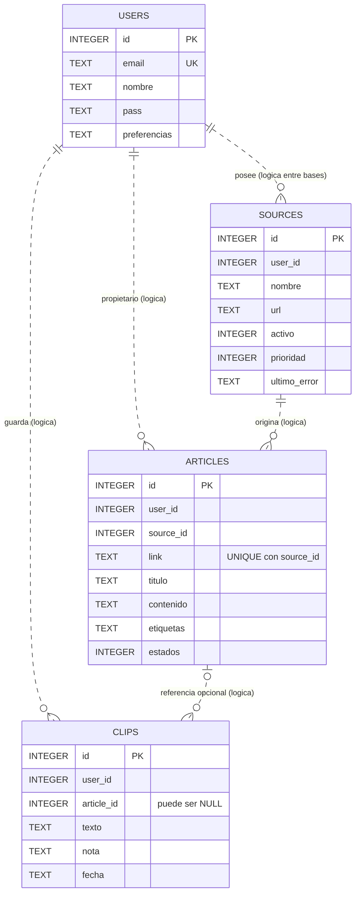

# Modelo relacional y diccionario de datos

Revisión: 26 de octubre de 2026. Se contrastó el DDL de los servicios con
`sqlite_schema` y `PRAGMA table_info` de las bases activas, sin exportar sus filas.




El Mermaid anterior es un resumen conceptual; `preferencias` y `estados` agrupan
campos para simplificar el dibujo, **no son columnas físicas**. El diccionario
y los archivos SQL siguientes son la descripción física completa.

## Separación de persistencia

| Archivo privado | Dueño | Contenido |
|---|---|---|
| `data/auth.db` | Auth | Tabla `users` y restricción única de correo |
| `data/feeds.db` | Feeds | Tablas `sources`, `articles`, `clips` e índices |
| `data/ia.json` | Agente | Configuración por clave `u<ID>`, no es una tabla SQL |
| `data/uploads/` | Auth | Imágenes de perfil, la tabla guarda solo su nombre |

Las claves primarias son enteros autoincrementales. Las relaciones marcadas
como lógicas **no tienen restricciones `FOREIGN KEY` declaradas** en el código.
`user_id` referencia conceptualmente a `users.id`, pero las bases son diferentes.
Feeds usa el JWT y filtros `user_id` para aislar datos. No hay JOIN SQL entre
Auth y Feeds. Los JOIN de `articles.source_id = sources.id` ocurren dentro de Feeds.

## `users` — auth.db

| Campo | Tipo / restricción | Significado / valor inicial |
|---|---|---|
| id | INTEGER PK AUTOINCREMENT | Identificador del usuario |
| email | TEXT UNIQUE NOT NULL | Correo normalizado |
| nombre | TEXT NOT NULL | Nombre visible |
| pass | TEXT NOT NULL | Sal y hash scrypt; no contraseña en texto plano |
| rol | TEXT | `user` por defecto; no hay consola administrativa |
| foto | TEXT nullable | Nombre del archivo de imagen |
| intereses | TEXT | JSON de etiquetas; `[]` |
| creado | TEXT | Fecha SQLite `datetime('now')` |
| idioma | TEXT | `es`; se permite `es` / `en` |
| tema | TEXT | `oscuro`; identificador del tema |
| fuente | TEXT | `sistema`; tipografía de la interfaz, no fuente RSS |
| tamano_texto | TEXT | `normal` |
| color_texto | TEXT | `auto` |
| tamano_iconos | TEXT | `normal` |
| aro | TEXT | `instagram` |
| tema_colores | TEXT | JSON de colores; `{}` |
| color_texto_hex | TEXT | Color personalizado o cadena vacía |

## `sources` — feeds.db

| Campo | Tipo / restricción | Significado / valor inicial |
|---|---|---|
| id | INTEGER PK AUTOINCREMENT | Identificador de fuente |
| user_id | INTEGER NOT NULL | Propietario lógico |
| nombre | TEXT NOT NULL | Nombre del medio |
| url | TEXT NOT NULL | Dirección real del feed detectado |
| activo | INTEGER | 1; activo/pausado |
| prioridad | INTEGER | 3; la aplicación limita de 1 a 5 |
| ultimo_error | TEXT nullable | Último fallo de importación |

No existe UNIQUE(user_id,url) físico; la ruta comprueba duplicados antes de insertar.

## `articles` — feeds.db

| Campo | Tipo / restricción | Significado / valor inicial |
|---|---|---|
| id | INTEGER PK AUTOINCREMENT | Identificador del artículo |
| user_id | INTEGER NOT NULL | Propietario lógico |
| source_id | INTEGER NOT NULL | Fuente lógica dentro de Feeds |
| titulo | TEXT nullable | Título original |
| link | TEXT nullable | URL original; UNIQUE con source_id |
| contenido | TEXT nullable | Texto RSS, hasta 4000 caracteres al importar |
| autor | TEXT nullable | Autor/creador o nombre del medio |
| fecha | TEXT nullable | Fecha normalizada a ISO al importar |
| etiquetas | TEXT | JSON de categorías; `[]` |
| leido | INTEGER | 0; booleano manejado por aplicación |
| favorito | INTEGER | 0 |
| archivado | INTEGER | 0 |
| saltado | INTEGER | 0; se excluye del feed |
| imagen | TEXT nullable | URL de imagen |
| video | TEXT nullable | URL incrustada permitida |
| titulo_es | TEXT nullable | Traducción de título |
| resumen_es | TEXT nullable | Extracto traducido para tarjeta |
| idioma | TEXT nullable | Idioma registrado |
| contenido_html | TEXT nullable | HTML del RSS, hasta 20000 caracteres |

## `clips` — feeds.db

| Campo | Tipo / restricción | Significado / valor inicial |
|---|---|---|
| id | INTEGER PK AUTOINCREMENT | Identificador del recorte |
| user_id | INTEGER NOT NULL | Propietario lógico |
| article_id | INTEGER nullable | Artículo asociado, sin FK |
| titulo | TEXT nullable | Copia del título al guardar |
| texto | TEXT nullable | Fragmento elegido (la ruta exige texto no vacío) |
| nota | TEXT nullable | Nota; hasta 1000 caracteres en la ruta |
| medio | TEXT nullable | Copia del nombre de la fuente |
| link | TEXT nullable | Copia del enlace original |
| fecha | TEXT | `datetime('now')` |

El recorte conserva su texto/título/medio/enlace como una instantánea. Al
eliminar una fuente se borran sus artículos, pero no sus recortes: `article_id`
puede quedar apuntando a un artículo que ya no existe. Es un límite real de
integridad referencial, no una cascada de FK. La visualización usa la instantánea.

## Índices y restricciones

- `users.email`: índice UNIQUE automático de SQLite.
- `articles(source_id, link)`: UNIQUE automático, evita reimportar la misma noticia por fuente.
- `idx_articles_user_fecha(user_id, fecha DESC)`.
- `idx_articles_user_estado(user_id, archivado, saltado, leido)`.
- `idx_articles_source(source_id)`.
- `idx_sources_user(user_id)`.
- `idx_clips_user_fecha(user_id, fecha DESC)`.
- WAL, `synchronous=NORMAL` y `busy_timeout=5000` en ambas bases al iniciar.
- Feeds usa `user_version=2` para la migración que abandona el HTML extraído de la web original.

## Reproducir el esquema vacío

[auth.sql](database/auth.sql) y [feeds.sql](database/feeds.sql) son independientes.
Con SQLite CLI, en una carpeta temporal nueva:

```bash
sqlite3 auth.db < docs/database/auth.sql
sqlite3 feeds.db < docs/database/feeds.sql
```

No se necesita SQLite CLI para ejecutar el portal: Node lo incluye y las rutas
crean/migran sus propias tablas. No importar estos archivos sobre bases activas.
