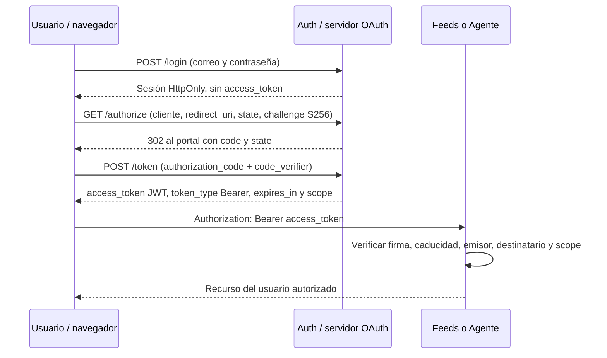

# OAuth 2.0 en Portal IA News

El microservicio **Auth** es el servidor de autorización. Utiliza la biblioteca
`@node-oauth/oauth2-server` y el cliente público registrado `portal-web`.
La interfaz utiliza **Authorization Code + PKCE S256** para entrar al portal.
No se añade un cuarto microservicio ni se necesita una cuenta de terceros.



## Rutas

| Método | Ruta dentro de Auth | Ruta pública con Nginx | Función |
|---|---|---|---|
| POST | /register | /auth/register | Crear cuenta y sesión de autorización |
| POST | /login | /auth/login | Comprobar credenciales y crear sesión HttpOnly |
| GET | /authorize | /auth/authorize | Autorizar cliente y emitir código con redirección |
| POST | /token | /auth/token | Canjear código con PKCE, respuesta OAuth Bearer |
| POST | /logout | /auth/logout | Eliminar sesión de autorización y limpiar cookie |

El token endpoint recibe **application/x-www-form-urlencoded**, no JSON.
Registro/login ya no entregan un token JWT directo; el acceso se obtiene con
el canje OAuth. Las cuentas existentes se conservan y se puede entrar con sus
mismas credenciales. Las sesiones anteriores necesitan iniciar sesión de nuevo.

## Datos y permisos

- Cookie de sesión: opaca, HttpOnly, SameSite=Lax, 10 minutos; Secure cuando se usa HTTPS.
- Código: aleatorio, un solo uso, 60 segundos. Una verificación PKCE fallida también consume el código.
- Base `auth.db`: `oauth_sessions` y `oauth_codes` almacenan hashes, no cookies/códigos en claro.
- Token de acceso: JWT firmado HS256, emisor `portal-auth`, destinatario `portal-api`, duración de 8 horas.
- Permisos: `profile` para Auth, `feeds` para Feeds y `ai` para Agente.
- El navegador conserva el verificador y `state` en sessionStorage, valida el retorno y limpia la URL.
- El access token queda en sessionStorage de la pestaña. El cierre de sesión lo elimina del navegador y borra la sesión de autorización.
- Un access token ya emitido es autocontenido: expira a las 8 horas; no se emiten refresh tokens ni se afirma revocación instantánea del JWT en los otros servicios.
- El JWT de servicio usado internamente por Feeds conserva su flujo separado; no es el login del usuario.

## Configuración del cliente

`portal-web` es un cliente público: **no guarda un client_secret en el navegador**.
PKCE liga el código al verificador de la pestaña que empezó el flujo.

Las URLs de retorno se comparan exactamente con `OAUTH_REDIRECT_URIS`. Por
defecto son las raíces de localhost/127.0.0.1 en los puertos 80, 8080 y 8090.
Para otra dirección, registrarla en `.env` y aplicar el despliegue. Fuera de
localhost se requiere HTTPS; configurar también CORS para orígenes separados.
No habilitar comodines de redirección.

## Probar con Postman

1. Hacer `POST http://localhost/auth/login` con JSON de correo/contraseña.
   Conservar la cookie de esa respuesta en el cookie jar.
2. Generar un `code_verifier` aleatorio de 43–128 caracteres válidos y su
   `code_challenge = BASE64URL(SHA256(code_verifier))`, sin relleno `=`.
3. Hacer `GET http://localhost/auth/authorize` con estos parámetros:

```text
response_type=code
client_id=portal-web
redirect_uri=http://localhost/
scope=profile feeds ai
state=VALOR_ALEATORIO_PRIVADO
code_challenge=CHALLENGE_CALCULADO
code_challenge_method=S256
```

4. Desactivar el seguimiento automático de redirecciones para inspeccionar
   el `Location` del 302. Comprobar `state` y tomar el `code`, sin publicarlos.
5. Canjearlo con `POST http://localhost/auth/token`, Body **x-www-form-urlencoded**:

```text
grant_type=authorization_code
client_id=portal-web
redirect_uri=http://localhost/
code=CODIGO_RECIBIDO
code_verifier=VERIFICADOR_ORIGINAL
```

6. Usar `access_token` como Bearer en `/auth/me`, `/feeds/feed` y `/agente/config`.
   No publicar cookies, códigos, verificadores ni tokens en capturas o colecciones.

Para la demostración habitual no hace falta introducir estos parámetros:
**el formulario de la aplicación hace todo el flujo OAuth automáticamente**.

## Pruebas

`tests/oauth.test.js` ejecuta el servidor de la biblioteca con SQLite en memoria
y peticiones HTTP; no simula respuestas OAuth. Comprueba éxito, PKCE incorrecto,
códigos usados/vencidos, canje concurrente, redirecciones, sesiones, origen web,
scopes y validación de `state` en el cliente.

La integración con registro/login real y los tres servicios se verifica en
una copia aislada: [oauth-integracion.txt](evidencias/oauth-integracion.txt).
